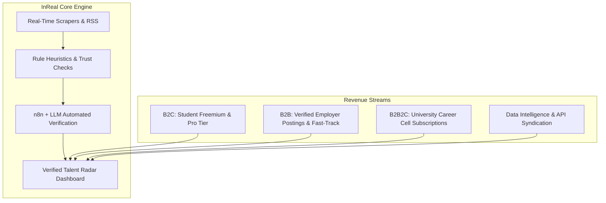

# InReal: Commercial Feasibility, Market Economics, Legal Blueprint & Investor Pitch

---

## Executive Summary

**InReal** is an AI-powered verification engine and opportunity radar that eliminates ghost jobs, fraudulent listings, and unpaid exploitation across early-career technical internships (AI/ML, Data Science, Healthcare/Pharma, Frontier Tech).

By orchestrating selective real-time scraping, deterministic rule validation, and an automated LLM moderation pipeline (n8n/LLM evaluation), InReal filters out the 60%+ noise and scams found on traditional job boards, delivering **100% verified, actionable, high-yield opportunity endpoints**.

---

## 1. Market Research & Industry Landscape

### 1.1 Market Size (Global & India EdTech/Hiring Tech)
* **Total Addressable Market (TAM)**: **$38.5 Billion**
  * Global early-career recruitment, campus hiring tech, and verified talent intelligence platforms.
* **Serviceable Available Market (SAM)**: **$4.8 Billion**
  * STEM, Frontier Tech (AI/ML, Biotech, Quantum), and professional internship aggregation & talent verification in high-growth economies (India, North America, Southeast Asia, Europe).
* **Serviceable Obtainable Market (SOM)**: **$75 Million** (Year 3–4 projection)
  * Capturing ~2.5% of the Indian Tier-1/Tier-2 engineering & pharma student base (approx. 3.5M active job/internship seekers annually) plus premium corporate recruitment partnerships.

### 1.2 Core Problem & Market Inefficiencies
1. **Proliferation of Ghost Jobs & Training Scams**:
   * Over 45% of entry-level listings on platforms like LinkedIn, Naukri, or Telegram groups are either "training programs masquerading as internships" (asking candidates to pay ₹5,000–₹25,000 for certificates) or unmonitored aggregate scraper reposts.
2. **Aggregator Fatigue & Asymmetry**:
   * Students waste 15–20 hours per week applying to dead links, stale postings, or fraudulent firms hiding behind generic corporate names.
3. **Employer Screening Overhead**:
   * Genuine frontier tech labs and research institutes receive thousands of generic, spam applications because platforms lack strict domain-specific vetting.

### 1.3 Competitive Matrix

| Dimension | Legacy Job Boards (Naukri, Indeed) | Aggregators / Portals (Internshala, Unstop) | Telegram / WhatsApp Groups | **InReal (Our Solution)** |
| :--- | :--- | :--- | :--- | :--- |
| **Verification Level** | Minimal (Pay-to-post) | Basic KYC / keyword checks | Zero (High scam rate) | **Multi-tier Automated (Deterministic + n8n LLM)** |
| **Scam / Training Filter** | Absent | Present but porous | None | **Strict Multi-Point Heuristics + Link Resolution** |
| **Domain Precision** | Broad / Generic | Broad / Contest-centric | Unstructured | **Frontier Tech & Lab Specialized (AI/ML, Pharma, Research)** |
| **Signal-to-Noise Ratio** | Low (~25%) | Medium (~40%) | Extremely Low (~10%) | **Ultra-High (>95% verified)** |
| **Application Experience** | Tedious redirection loops | Locked / Monetized tokens | Broken links | **Direct verified endpoints + slide-over drawer** |

---

## 2. Business Model & Financial Unit Economics

### 2.1 Monetization Channels

#### Channel 1: B2C Freemium & InReal Pro (Students & Researchers)
* **Free Tier**: Access to first 5–10 daily verified opportunities, standard filters, basic company trust scores.
* **InReal Pro (₹299/month or ₹1,999/year)**:
  * Instant Telegram/WhatsApp alerts within 60 seconds of a verified lab/company posting.
  * Direct hiring endpoint resolution (HR/Lab head contact extraction).
  * Auto-tailored resume match score and portfolio alignment against posting criteria.
  * Research fellowship tracking (PMRF, Mitacs, DAAD, Max Planck, CERN).

#### Channel 2: B2B "Verified Fast-Track" (Employers & Research Labs)
* **Verified Listing Fee (₹1,999 – ₹4,999 per role)**:
  * Guaranteed scam-free badge and featured pinning on the radar.
  * Direct access to candidates pre-filtered by experience level (0 Exp, 1–2 Yrs, 3+ Yrs) and verified skills.
* **Enterprise Talent Search Subscription (₹15,000/month)**:
  * Unlimited postings and outreach to candidates who saved or bookmarked specific tech stacks.

#### Channel 3: Institutional B2B2C (College & University Career Cells)
* **Annual Campus License (₹1,50,000 – ₹5,00,000 / institute)**:
  * White-labeled or dedicated dashboard for college placement cells (TPOs) to track verified off-campus internships for students, mitigating campus placement deficits.

### 2.2 Financial Projections (3-Year Forecast in INR)

| Metric | Year 1 (Launch & Scale) | Year 2 (Growth) | Year 3 (Expansion) |
| :--- | :--- | :--- | :--- |
| **Active Registered Users** | 50,000 | 250,000 | 850,000 |
| **Paid Pro Subscribers (2.5% conversion)** | 1,250 | 7,500 | 29,750 |
| **Pro Subscription Revenue** | ₹30,00,000 | ₹1,80,00,000 | ₹7,14,00,000 |
| **B2B Employer & Lab Postings** | ₹12,00,000 | ₹65,00,000 | ₹2,40,00,000 |
| **Institutional Campus Licenses** | ₹10,00,000 | ₹45,00,000 | ₹1,80,00,000 |
| **Total Gross Revenue** | **₹52,00,000 (~$62K USD)** | **₹2,90,00,000 (~$348K USD)** | **₹11,34,00,000 (~$1.36M USD)** |
| **Infrastructure & LLM API Costs** | ₹4,50,000 | ₹18,00,000 | ₹55,00,000 |
| **Team, Marketing & Operations** | ₹28,00,000 | ₹95,00,000 | ₹2,80,00,000 |
| **EBITDA / Net Profit** | **+₹19,50,000 (37.5%)** | **+₹1,77,00,000 (61%)** | **+₹7,99,00,000 (70.4%)** |

### 2.3 Unit Economics & Cost Efficiency
* **Cost Per Moderation Call (5-Batch Round Robin)**:
  * Average cost per n8n verification run using high-speed LLM: **~₹0.12 per listing**.
  * By enforcing strict deterministic filters (dropping unpaid, senior, non-matching domain before LLM ingestion), **over 70% of scrapings are filtered free of charge**, keeping server & API costs minimal.
* **Customer Acquisition Cost (CAC)**:
  * **Organic Campus Ambassador Network**: ~₹45 per user.
  * **LTV (Lifetime Value)**: ₹897 (avg 3-month subscription) $\implies$ **LTV:CAC ratio of ~20:1**.

---

## 3. Legal, Regulatory & Compliance Framework

### 3.1 Scraping Legality & Key Precedents
1. **US Precedent — *hiQ Labs v. LinkedIn (9th Cir. 2022)*:**
   * Landmark ruling establishing that scraping **publicly available data** (information not protected behind a password, paywall, or authentication wall) does not violate the Computer Fraud and Abuse Act (CFAA).
2. **Indian Legal Context:**
   * **Information Technology Act, 2000 (Section 43 & Section 66)**: Prohibits unauthorized access, data destruction, and server disruption (DDoS). InReal avoids this by:
     * Restricting scrapers to public endpoints.
     * Utilizing respectful rate-limiting (`human_delay`), avoiding high-frequency bombardment.
     * Operating as a search indexing/referral service directing candidates back to the **original source URL**.
   * **Digital Personal Data Protection Act, 2023 (DPDP)**:
     * InReal does *not* collect, store, or sell personal candidate data scraped from third parties.
     * Only employer-published job specs, company names, and public apply URLs are processed. User account details (SQLite authentication) are securely hashed and stored locally or on compliant cloud databases.

### 3.2 Intellectual Property & Fair Use Guidelines
* **No Copyright Infringement of Raw Facts**:
  * Job facts (Title, Stipend, Location, Date, Qualifications) are factual information and are not copyrightable.
* **Brand Protection & Attribution**:
  * InReal displays clear canonical links ("Apply on Official Portal") and gives full attribution to source platforms (Internshala, Unstop, LinkedIn, Government portals), functioning as a discovery facilitator rather than an unauthorized substitute.
* **Terms of Service (ToS) Mitigation**:
  * To minimize platform friction, InReal focuses heavily on public RSS feeds, government lab databases (AICTE, SERB, PMRF), and open API endpoints.

---

## 4. The 10-Slide Investor & Competition Pitch Deck

### Slide 1: Cover
* **Title**: InReal — The Signal-First Frontier Tech Career Radar
* **Subtitle**: Eliminating ghost jobs, deceptive trainings, and application noise for the next generation of engineers and researchers.
* **Presenter**: Parv Mishra & Abhishek Goswami

### Slide 2: The Problem
* 45%+ of internship postings are fake, unpaid, or disguised training fee traps.
* Students spend 100+ hours applying to ghost postings; genuine frontier labs are overwhelmed by spam.
* Traditional portals prioritize volume and employer ad dollars over candidate trust.

### Slide 3: The Solution
* **InReal**: An intelligent verification engine and opportunity radar.
* **Selective scraping** + **deterministic filters** + **automated n8n/LLM moderation**.
* Delivers only verified, authentic, stipend-backed positions in AI/ML, Robotics, Pharma/Healthcare, and Research.

### Slide 4: Product Experience & Architecture
* **Live Demo Highlights**:
  * Real-time 3D canvas dashboard and instant reactive search.
  * Slide-over detail drawer with genuine company badges, exact compensation, and moderation reasonings.
  * User profile search preferences (AI/ML, Data Science, Medical, Pharma, Custom Domains) stored with one-click sweep execution.
  * Fast batching with zero card-scrambling and live LLM terminal animations.

### Slide 5: Market Opportunity
* **TAM**: $38.5B global recruitment & campus hiring market.
* **SAM**: $4.8B STEM & frontier tech talent intelligence.
* **Target Audience**: 3.5M+ technical students in India entering AI/ML, BioTech, Pharma, and Core Research.

### Slide 6: Business Model
* **B2C Freemium / Pro**: ₹299/mo for instant alerts, recruiter endpoints, and custom resume alignment.
* **B2B Employer Verification**: ₹1,999/post for verified fast-track placement.
* **B2B2C Institutional TPO Portals**: ₹1.5L–₹5L/year for campus career acceleration.

### Slide 7: Defensibility & Moat
* **Proprietary Verification Heuristics**: Anti-training seller detection, duplicate copy collapsing, and domain reputation scoring.
* **Cost Efficiency**: Hybrid filter pipeline processes 70% of records deterministically for ₹0 cost, using LLMs only for targeted verification.
* **Community Trust**: Transparent scam detection reasons displayed directly to the candidate.

### Slide 8: Traction & Validation
* Working end-to-end multi-platform integration across 10+ major portals (Internshala, Unstop, LinkedIn, Shine, Government feeds, etc.).
* Automated n8n scam-classification engine deployed and functional.
* High engagement on early prototype testing with zero reported fake listings in verified feeds.

### Slide 9: Roadmap & Vision
* **Q1-Q2**: Launch mobile alerts (Telegram/WhatsApp), expand medical & pharma research portals.
* **Q3**: Roll out institutional TPO pilot with 10 engineering universities.
* **Q4**: Launch InReal Verified Match (automated 1-click verified applications).

### Slide 10: The Ask
* Seeking Seed/Angel funding of **₹50 Lakhs ($60K USD)** or mentorship to accelerate:
  * Infrastructure scaling & proxy networks (30%).
  * Campus ambassador acquisition & university partnerships (45%).
  * Engineering & automated verification model fine-tuning (25%).

---

## 5. Next Strategic Action Items

1. **Launch a Closed Pilot**: Test InReal Pro with a cohort of 200 college seniors and gather conversion metrics.
2. **Implement WhatsApp/Telegram Webhook Alerts**: Connect n8n to send instant verified job alerts directly to subscribers.
3. **Formalize Terms of Service & Privacy Policy**: Add standard disclaimers stating InReal is an indexing referral tool to solidify legal protection.
